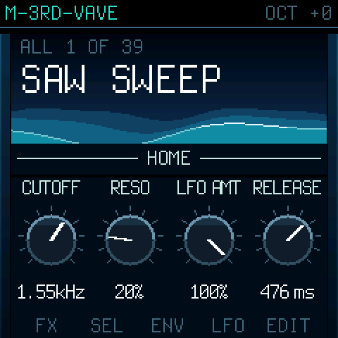
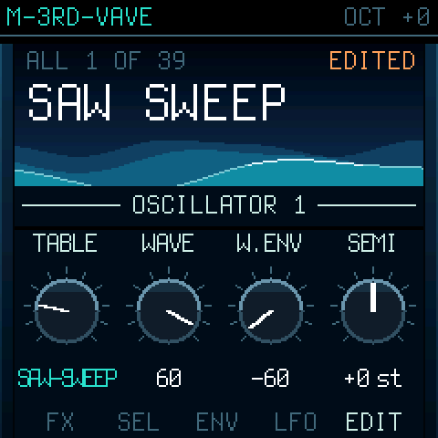

# M-3rd-VAVE

A wavetable polysynth for the M-VAVE FM-1, after the Groove Synthesis 3rd Wave, on the PPG Wave 2.2's own
wavetables. It runs as a module in [fm1-dock](https://github.com/joakimeriksson/fm1-dock).

 

- **The sound:** 24 voices with fm1-dock's second core (12 without). Each voice has three wavetable oscillators,
  noise, a resonant 4-pole low-pass filter, and amp, filter and wave envelopes. The waves are the PPG Wave 2.2's
  28 ROM wavetables (00 RESONANT to 27 FMNTVOCAL), kept in 8 bits and band-limited for each note. A position moves
  through a table in the PPG's steps, driven by the wave envelope and the LFO.
- **Unison:** up to 4 voices a key, detuned and spread across the stereo field.
- **LFO:** synced to the tempo, from 8 bars to 1/32. It moves the pitch, the cutoff and each oscillator's wave. HOME's LFO AMT adds movement to any preset: up to 18 steps through every wavetable, 1.2 octaves of cutoff and 12 cents of pitch, on top of what the preset does itself (0 leaves the preset as made).
- **Delay:** a ping-pong delay with a darkening feedback loop.
- **39 presets** in seven types, at least five each, plus INIT.
- **Chord generator, arpeggiator and loop recorder,** laid out and played as on
  [PRO-FM-78](https://github.com/hamperj/pro-fm-78). They follow a DAW's MIDI clock.
- **Kept over a power-off:** the preset, your edits to it, the players' settings and the octave.
- **The screen:** three waves roll under the preset name and rise with the sound.

## Install

Download `m3rdvave.dock` from the [latest release](https://github.com/hamperj/m-3rd-vave/releases/latest) (or build
it, see below), then deploy it from fm1-dock:

```sh
uv run --with python-rtmidi tools/dock.py deploy /path/to/m3rdvave.dock
```

The module takes about 114 KiB of fm1-dock's module space. If a deploy replaces a copy that is running, switch the
FM-1 off and on again afterwards: fm1-dock 0.7.1 can crash at that point and then keeps its second core off until
a power cycle.

## Controls

| Control | What it does |
| --- | --- |
| Keys / MIDI | Play notes. Key force gives velocity |
| OCT- / OCT+ | Shift the keys' octave, shown on the top line |
| ALGORITHM | Choose a type: ALL, PAD, KEYS, BASS, LEAD, BELLS, PLUCK, FX, INIT |
| PRESETS, SELECT | Choose a preset of that type |
| HOME | Cutoff, resonance, LFO AMT (added movement: wave, cutoff, pitch) and amp release on KNOB 1–4. Hold for 1.5 s to open fm1-dock's module list |
| EDIT | Filter; oscillators 1, 2 and 3 (table, wave, wave envelope amount, semitones); fine tuning |
| FX | Mixer (the three oscillators, noise); delay (time, feedback, mix, stereo spread); voices (unison, detune, amp and filter velocity) |
| SEL | Chord generator: chord, inversion, voicing, strum |
| ENV | Filter, amplifier and wave envelopes |
| LFO | Rate (a beat division), vibrato, cutoff, amount; then how far it moves each oscillator's wave |
| ARP | Arpeggiator: mode, rate, octaves, gate. Press again for tempo, swing, latch, velocity |
| SEQ | Loop recorder: tempo, bars, click, transpose |
| PLAY | Start or stop the loop |
| REC | When stopped: arm (your first note starts recording). When playing: overdub on or off. Hold for 1 s to clear the loop |
| SAVE | Keep the loop in flash. It only saves once the loop is stopped and the notes have faded |
| CC 74 71 73 72 | Cutoff, resonance, amp attack, amp release |

Each section button steps through its pages, then back to HOME. The knobs show their values in real units.

## Presets

| Type | Presets |
| --- | --- |
| PAD | SAW SWEEP, VOX PAD, WIND, RESO SWEEP, PULSE PAD, GLASS PAD, POLATED, STRINGS |
| KEYS | E.PIANO, ORGAN SYN, ADD HARM, STRONG KEYS, PERC ORGAN, CLAV WAVE |
| BASS | RESO BASS, SOFT BASS, SUB WAVE, PLUCK BASS, VOX BASS |
| LEAD | CLIP LEAD, SQR LEAD, SQRSAW BRASS, SUPER SAW, UNI LEAD |
| BELLS | DIGI BELL, GLASS BELLS, MALLET, TINE BELL, HARM BELLS |
| PLUCK | TRANSIENT, FEEDBACK, RESO PLUCK, HARP WAVE, SYNC PLUCK |
| FX | ROBOTIC, HP RESO, SEA SPRAY, DATA STREAM, TIDE RISER |

## Build

You need [fm1-dock](https://github.com/joakimeriksson/fm1-dock) checked out next to this repository (or set
`FM1_DOCK`), and its JieLi toolchain (`JIELI_TOOLCHAIN`). See fm1-dock's README. On macOS the toolchain runs in
Docker. Built and tested with fm1-dock 0.7.1.

```sh
./build.sh            # build/m3rdvave.dock
tests/run_host.sh     # every check on this computer, plus build/host/wav/*.wav and the screens as PNG
```

`m3rdvave/gen_tables.py` regenerates `m3rdvave/eng/w3_tables.h` from `m3rdvave/ref/ppg_data.c`.

## Measured on an FM-1

With a big four-voice-unison chord (all 24 voices), the render takes at most 56% of an audio block across the two
cores, with no overruns. On one core it is capped at 12 voices.

## Credits and licence

GPL-3.0-only. See [LICENSING.md](LICENSING.md) and [LICENSE](LICENSE).
